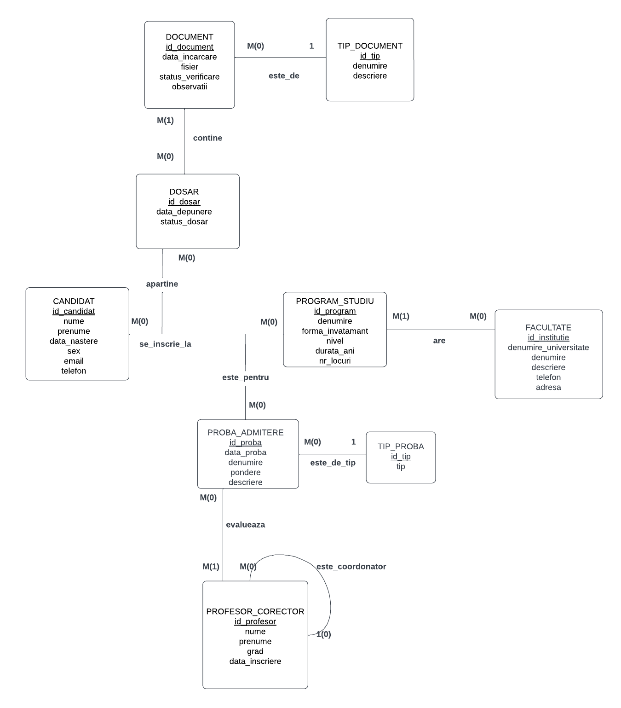
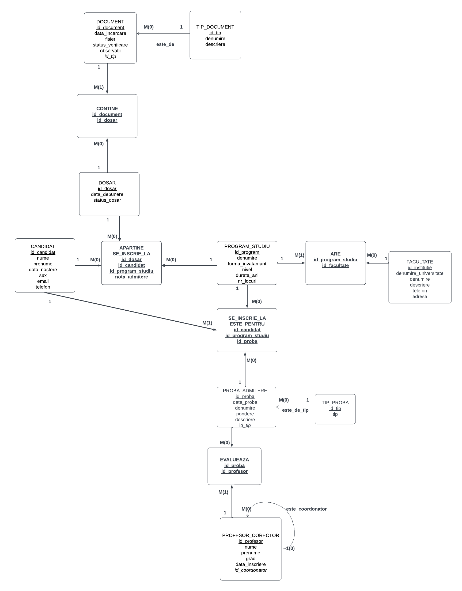

## Project Overview

The **University Admission Management System** is a database-driven project designed to support and manage the admission process of a higher education institution, such as a university with one or more faculties.

The system covers the entire admission workflow, from candidate registration and application submission to document verification, admission examination management, examiner assignment, and final admission grade calculation.

Its main goal is to provide a centralized and structured solution for managing candidates, academic programs, admission applications, examination results, and the academic staff involved in the evaluation process.

## Project Diagrams

## Scope and Functional Requirements

### 1. Institutional Structure

- A university consists of one or more faculties.
- Each faculty offers one or more study programs.
- Study programs can have different academic levels (Bachelor's, Master's, etc.).
- Each program is defined by its study format, duration, and available number of admission places.

### 2. Candidate and Application Management

- The system maintains a centralized database of candidates.
- A candidate can apply to one or more study programs.
- Each application is managed through a separate admission file.
- Every admission file stores:
  - Submission date.
  - Application status (Pending, Approved, Rejected).
  - Final admission grade.

### 3. Document Management

- Each admission file must contain one or more supporting documents.
- Documents are classified according to predefined document types, such as:
  - Educational diplomas.
  - Identity cards.
  - Birth certificates.
  - Other required supporting documents.
- Each uploaded document has its own verification status, allowing the university to track the document validation process.

### 4. Admission Examination Management

- Each study program may require candidates to take one or more admission examinations.
- Examinations can have different types, such as:
  - Written examinations.
  - Oral examinations.
  - Interviews.
  - Other assessment methods.
- Each examination type has a predefined weighting factor used in the calculation of the final admission grade.
- Candidates can register for multiple examinations within each study program they apply to.
- Examination results are recorded and associated with the corresponding candidate and admission application.

### 5. Examiner Management

- Each admission examination is evaluated by one or more examiners (professors).
- The system supports assigning examiners to specific examinations.
- Examiners can be organized in a hierarchical structure, where a professor may coordinate and supervise other examiners.
- This structure allows the university to manage evaluation responsibilities and coordinate the examination process.

## Main System Features

The system provides the following functionalities:

- Centralized management of candidates and their personal information.
- Creation and tracking of admission applications.
- Management and verification of application documents.
- Organization of the university structure (University → Faculties → Study Programs).
- Configuration of admission examinations and their weighting factors.
- Registration and tracking of candidate examination participation.
- Recording and managing examination grades.
- Assignment of examiners to admission examinations.
- Management of hierarchical relationships between examiners.
- Automatic calculation and storage of the final admission grade for each application.
- Tracking of the admission status throughout the entire process.

## Project Objective

The objective of this project is to design and implement a relational database that accurately models the university admission process, ensuring data consistency, integrity, and efficient information management.

The database aims to provide a reliable foundation for an admission management application that can simplify administrative operations, improve examination coordination, and facilitate the evaluation and selection of candidates.

## Database Scope

The database covers the following main entities:

- Universities
- Faculties
- Study Programs
- Candidates
- Admission Applications
- Documents
- Document Types
- Admission Examinations
- Examination Types
- Candidate Examination Registrations
- Examination Results
- Examiners
- Examiner Hierarchies

